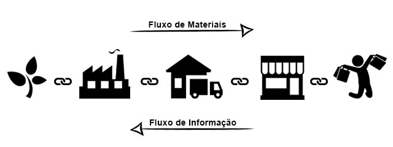
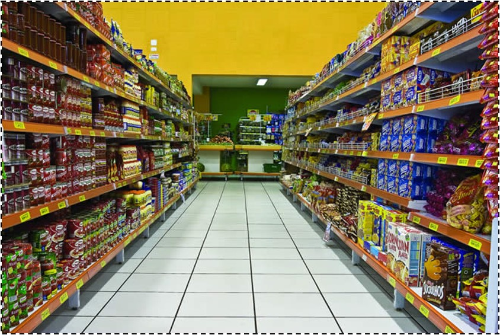
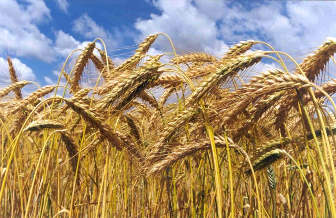
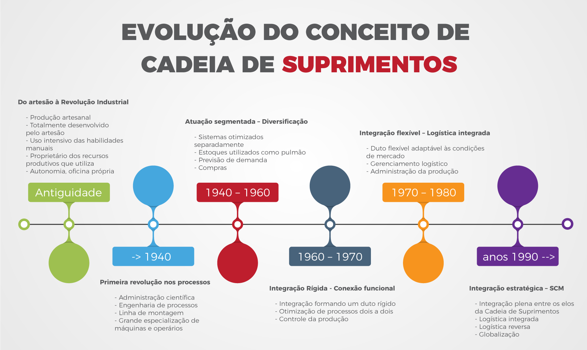

```{r child = "setup.Rmd"}
```

```{r xaringan-tile-view, echo=FALSE}
xaringanExtra::use_tile_view()
```

```{r xaringan-editable, echo=FALSE}
xaringanExtra::use_editable(expires = 1)
```

```{r xaringanExtra-clipboard, echo=FALSE}
htmltools::tagList(
  xaringanExtra::use_clipboard(
    button_text = "<i class=\"fa fa-clipboard\"></i>",
    success_text = "<i class=\"fa fa-check\" style=\"color: #90BE6D\"></i>",
    error_text = "<i class=\"fa fa-times-circle\" style=\"color: #F94144\"></i>"
  ),
  rmarkdown::html_dependency_font_awesome()
)
```

```{r xaringan-fit-screen, echo=FALSE}
xaringanExtra::use_fit_screen()
```

```{r xaringan-extra-styles, echo=FALSE}
xaringanExtra::use_extra_styles(
  hover_code_line = TRUE,         #<<
  mute_unhighlighted_code = TRUE  #<<
)
```

```{r xaringan-scribble, echo=FALSE}
xaringanExtra::use_scribble()
```

class: middle, center, inverse


## Quem sou eu???

```{r, echo=FALSE, message=FALSE, warning=FALSE, out.width="30%"}

```


---

class: middle, center, inverse

## Mundo do trabalho
## 4a revolução industrial
## Pandemia Sars-CoV-2
## Guerras
## Tarifaços

---

class: center

# Logística

Pergunte a definição/conceito de **Logística** para uma AI como o ChatGPT ou Deepseek. Seja criativo e pergunte colocando algum contexto diferente daquele formal. Como exemplo: "Como o chefe do PCC definiria **Logística**?"

`r countdown(minutes = 5, seconds = 00, left = 0, right = 0, padding = "50px", margin = "5%", font_size = "6em", play_sound = TRUE)`

---

## O que é Logística?

Penso que o logística é muito mais um conjunto de princípios do que uma operação. "Fazer" `logística` relaciona-se à **promover o acesso a bens de consumo  e serviços, essenciais à vida humana e promovidos pelo consumo, destinados ao consumidor final da maneira mais eficiente e responsiva possível**. 

.question[
“**Logística** é dispor a **mercadoria ou o serviço** certo, no **lugar** certo, no **tempo** certo e nas **condições desejadas**, ao mesmo tempo em que fornece a **maior contribuição à empresa**”. 
(Ballou, 2001)
]

---

# O que é uma cadeia de suprimentos?
.question[
A cadeia de suprimentos é a integração dos processos industriais e comerciais, partindo dos fornecedores iniciais até o consumidor final, gerando produtos, serviços e informações que agreguem valor para o cliente, maximizando a lucratividade total.
]
```{r echo=FALSE, message=FALSE, warning=FALSE}

```

---

# Como esses conceitos passaram a fazer parte das nossas vidas?

.pull-left[
```{r echo=FALSE, message=FALSE, warning=FALSE}

```
```{r echo=FALSE, message=FALSE, warning=FALSE}

```
]

.pull-right[
```{r echo=FALSE, message=FALSE, warning=FALSE}

```
]

---
# Evolução da logística 

```{r echo=FALSE, message=FALSE, warning=FALSE}

```


